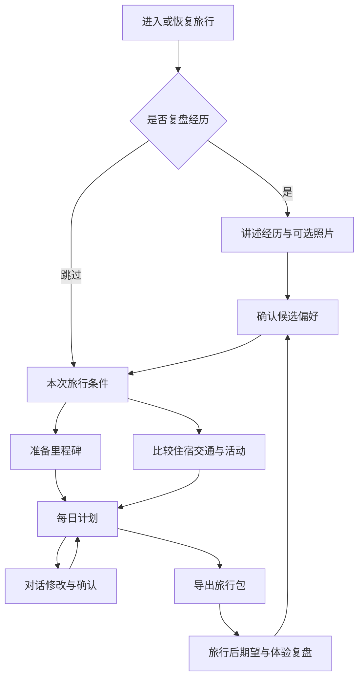

# LetsGoTravel 产品需求文档（PRD）

版本：v0.1 · 日期：2026-10-27 · 状态：产品规划基线，待真实用户验证。

本文定义产品目标、能力边界、需求优先级与验收；[MVP 实施文件](MVP-implementation-v1.md)定义第一版布局参数与工程落地。已确认的用户决策优先于文档；发生冲突时应同步修订两份文件，不能沿用旧渲染图覆盖新决策。

当前成果仅包括规划文档和首张概念图。网站、英国签证模板、推荐质量、真实数据接口与用户效果均尚未验证。

## 1. 产品定位

LetsGoTravel 是以对话为入口、以可执行计划为交付、以真实旅行复盘持续改进的个性化旅行工作台。面向希望有准备、有依据、有选择权的自由行旅行者；优先发展出境旅行，也保留国内旅行的通用规划能力。

产品承诺：旅行者能够理解推荐理由、确认下一步任务、修改计划，并带走可用的旅行资料。对话与计划保持关联，计划无需依赖重新阅读聊天记录才能使用。

“J 人最爱”描述对确定性和组织感的偏好，不将 MBTI 或固定人格标签作为推荐依据。计划允许留白、取消和临时调整。

### 1.1 核心问题与待验证假设

| 问题假设 | 产品响应 | 验证方式 |
|---|---|---|
| 签证、机酒、地图与攻略分散，准备次序不清楚 | 里程碑、前置依赖和下一任务 | 旅行者能独立说清并执行下一步 |
| 通用攻略无法解释为什么适合某个人 | 经历复盘、确认偏好、候选取舍 | 对比有无偏好信息的推荐，并记录原因 |
| 一次性长篇输出难以消化 | 分阶段、少量候选、按需展开 | 观察任务完成、回退和求助情况 |
| 对话修改会重写无关部分 | 稳定条目、锁定、变更预览和撤销 | 固定用例验证修改范围与冲突处理 |
| 上次经历没有影响下次计划 | 期望与实际反馈更新偏好 | 旅行者能辨认复盘带来的具体变化 |

以上是产品假设，不是已获研究验证的市场结论。

### 1.2 非目标

首版不成为旅行交易平台或签证代办机构，不承诺获签、实时库存、绝对安全或保证满意；不训练人格分类器，不自动根据照片推断身份、收入或心理特征。交易、预约及提交签证申请留在对应提供方。

## 2. 用户与验证范围

首个重点验证目的地为伦敦，原因是发起人拥有较丰富的亲身经验，可提供内容评审与真实案例。伦敦是验证起点，不是账户准入条件。

出发地、护照、合法居住地、职业、人数、天数与预算均为变量，不固定为北京、学生、双人或某个天数。首版集中验证伦敦市内与抵离交通，复杂跨国和偏远多城路线需标明尚未系统验证。

主要使用情境：

- 首次自助出境：需要明确准备路径和信息依据。
- 有旅行经验：希望复用自身偏好，减少重复搜索。
- 已有机酒安排：需要围绕锁定项目完善每天，而非重新规划全部。
- 重视摄影、美食或舒适度：需要表达具体取舍，而非仅选择一个风格标签。

单人操作支持多位同行者的需求输入；首版不提供多个账户实时共同编辑。同行者需求按匿名角色输入，只收集规划必要信息。

## 3. 已确认决策

| 决策 | 产品含义 |
|---|---|
| 伦敦优先验证 | 内容、示例和人工评审以伦敦为主；签证按英国规则独立建设 |
| 极简液态玻璃＋少量手绘 | 导航和控件有材质感，正文可读；手绘用于温度与总览 |
| 底部对话舱，可移动 | 取消右侧常驻聊天；桌面可停靠；移动端底部展开 |
| 用户信息非强制、默认不云存储 | 无注册也能规划；本地数据与云端模型处理分别说明 |
| 经历驱动偏好 | 所有模型推断先是候选，确认后才用于长期画像 |
| 渐进式规划 | 每次聚焦当前决定，允许跳过、返回和暂定 |
| 可导出 | PDF 手册、PNG 分享卡、JSON 可恢复备份 |

旧巴黎渲染图仅代表配色与材质，已不代表当前目的地和布局。新版伦敦底部对话舱渲染尚未制作。

## 4. 完整用户旅程

此流程不强制串行。已有入境许可或暂不需要签证建议的旅行者可直接规划；已订酒店可直接作为约束输入。未填写日期仍可比较风格和区域，但不能给出日期相关的确定库存、营业或预约结论。

首次价值时刻：旅行者确认一项偏好，并看见它对候选或计划产生明确影响。回访价值：无需重新介绍背景，仍能理解当前进度和下一项决定。

### 4.1 伦敦端到端测试故事（合成示例）

旅行者描述上次“酒店漂亮但通勤疲惫、餐厅出片却口味一般”，确认交通与口味优先。本次输入伦敦旅行条件、预算口径和一个已订活动。系统提供两个住宿区域候选，展示交通取舍、来源与未知项；生成每日草稿。旅行者提出“第三天晚出门”，系统显示变更，保留已锁定活动，冲突时给出选择。旅行者确认后导出手册，再导入 JSON 恢复同一版本。

该故事用于测试产品行为，不包含真实酒店、价格或已核实路线。

## 5. 功能范围与优先级

P0：首版发布必需；P1：个人规划闭环验证后扩展；P2：规模和数据条件成立后探索。优先级不是日期承诺。

| ID | 需求 | 输入 → 输出 | 优先级 |
|---|---|---|---|
| F01 | 创建、恢复与管理旅行 | 目的地及可选条件 → 本地旅行草稿 | P0 |
| F02 | 自由文字复盘与照片说明 | 经历、花费、遗憾、可选照片 → 经历卡 | P0 |
| F03 | 偏好确认与编辑 | 候选推断及人工更正 → 有范围与证据的偏好 | P0 |
| F04 | 分轮需求澄清 | 条件和缺口 → 已知、暂定、待确认简报 | P0 |
| F05 | 英国访客准备流程 | 身份条件与核验模板 → 里程碑、清单、官方入口 | P0 |
| F06 | 住宿区域与候选比较 | 偏好、预算、时间 → 2—3 个有取舍的候选 | P0 |
| F07 | 交通与机酒搜索衔接 | 出发地日期、用户报价 → 搜索跳转及比较记录 | P0 |
| F08 | 每日行程与地图切换 | 选定项目、约束 → 可编辑每日计划 | P0 |
| F09 | 局部修改、锁定与撤销 | 指令、目标、版本 → 变更预览与新版本 | P0 |
| F10 | 预算与费用口径 | 人数、币种、已付/估算项目 → 分项及缺口 | P0 |
| F11 | 导出与恢复 | 计划快照及内容选择 → PDF/PNG/JSON | P0 |
| F12 | 本地数据管理与权限 | 使用选择 → 保存、删除、备份、处理授权 | P0 |
| F13 | 轻量推荐与旅后反馈 | 替换理由、期望差距 → 偏好调整提议 | P0 |
| F14 | 视觉辅助理解复盘 | 单独授权的图片 → 待确认的视觉偏好线索 | P1 |
| F15 | 日历、提醒与离线增强 | 确认时间 → ICS/明确渠道的提醒 | P1 |
| F16 | 多目的地、国内及多城 | 新目的地内容包 → 对应规划能力 | P1 |
| F17 | 实时报价接口 | 获准平台接口 → 带时效和条件的报价 | P1 |
| F18 | 多设备与同行协作 | 可选账户及同步授权 → 权限控制的共享计划 | P1，需重新定义云端承诺 |
| F19 | 群体推荐学习 | 自愿贡献且合适的数据 → 混合推荐 | P2 |
| F20 | 交易或代理预约 | 平台合作、明确授权 → 可追踪交易 | P2，独立立项 |

## 6. 核心业务规则

### 6.1 复盘与偏好（F02—F03、F13）

复盘结构为“事实—期望—实际体验—原因—下次选择”。一次经历最多先提出 3—5 条候选偏好，每轮追问 1—2 个有区分价值的问题，允许跳过。

偏好分长期、情境、本次三层。已花费金额不等于愿付价格；不选某个候选不等于不喜欢；上传照片不等于以摄影为旅行目的。照片在 P0 仅本地展示并由旅行者说明喜爱原因。

候选状态：proposed → confirmed/rejected；confirmed 可编辑或删除，保留必要的本地变更记录。新推断与旧偏好矛盾时询问适用情境，不自动覆盖。删除偏好后，新推荐不得继续使用该偏好；历史计划保留并可重新生成理由。

### 6.2 准备与签证（F05）

仅在需要时询问相关身份条件，不把签证问卷作为全站入口门槛。以 [英国官方资格检查](https://www.gov.uk/check-uk-visa)和[访客申请入口](https://www.gov.uk/standard-visitor/apply-standard-visitor-visa)为依据，规则模板由人工核验后发布。

里程碑包含目标、前置条件、建议完成日期、任务和来源；任务包含状态、材料类别、所需配合者及链接。官方时限、一般处理时间、产品建议缓冲期分别标识；预约等待与审理时间分开。日期变更需重新检查任务期限，不能静默将已预约时间平移。

材料状态首版记录“缺少/准备中/待核对/已备齐”，不接收证件原件。清单完成只代表准备记录，不代表文件真实有效或签证已获批准。已有许可者记录为本人声明，不由模型担保有效。

### 6.3 候选与推荐（F06—F08）

默认每轮两个候选、最多三个，支持“都不合适”及原因。每项输出包含适配理由、取舍、费用口径、来源、时效、下一操作。摄影、美食、安静、舒适、步行、位置、预算分开表达，安全信息具体到来源和条件，不生成绝对安全评分。

先筛硬约束，再比较软偏好。过敏、明确预算上限、营业/预约冲突不能被视觉吸引力抵消。约束无法同时满足时，解释冲突并询问允许放宽哪一项，不擅自放宽。

酒店建议先区域后具体房源；机票比较包含机场、时间、行李、转机、费用与退改的已知范围。实时库存未核验时不得标为可订。社交媒体用于风格和体验线索，规则与预约优先引用官方来源；图片须有可用权利与出处。

### 6.4 行程与修改（F08—F10）

日程按本地日期展示，默认早/午/晚层级，详细时间按需展开。交通估算必须区分直线距离、路线耗时和未取得信息。保留休息与弹性时间，约束留白并非“未规划”。

条目使用稳定 ID。对“那里”“那家店”等模糊指代无法唯一解析时先澄清。模型提出 patch，校验器检查目标、锁定、时间和版本；用户确认后原子提交。候选接受与自然语言明确修改都经过同一变更机制，不重复确认同一已授权动作。

已订、锁定和已付款是不同状态。锁定意味着自动规划不得变更；已付款仍可能允许退改，但其规则需有依据。旧网络响应不得覆盖新计划；取消后到达的响应不得自动写入。重复点击不得重复增加条目。

未知费用显示未知；预算包含已知总额与未计入项。换算值保存汇率及时间、原币种和原金额，避免反复换算漂移。超预算不能通过隐藏未定费用消除。

### 6.5 导出（F11）

“旅行总览 → 导出旅行包 → 选用途与内容 → 预览 → 保存”。PDF 用于离线阅读与打印，PNG 用于分享，JSON 用于恢复编辑。PDF 首版经专用打印页面调用浏览器保存功能。

导出来自同一计划快照，带版本与日期；保留暂定和估算状态。分享卡默认去掉住宿精确地址、确认码及私人经历。备份默认不打包照片二进制，导出前明确列出不包含的数据。无凭据进入任何导出。分享链接和云端托管不在 P0。

## 7. 信息架构与体验要求

一级入口为首页、旅行工作台、偏好/数据设置。工作台包含旅行偏好、出行准备、住宿与交通、每日行程、旅行总览五个分区，切换保留草稿和滚动上下文。

主内容居中、每屏一个主要问题；详情、地图和完整对话按需展开。底部玻璃对话舱显示正在讨论的对象，收起不遮挡主操作，展开显示最近对话。桌面可拖动停靠并一键复位，另提供位置菜单和键盘替代。移动端只支持底部展开，避免小屏任意漂浮。

视觉为珍珠白/冰蓝、深色正文、钴蓝主行动；玻璃用于外壳和操作层，内容层近乎不透明。手绘约占工作台 3—5%，用于地标和轻量标记；准确地址、日期和地图由结构化数据渲染。详细 token 与断点见实施文件。

每个页面必须具备：空状态、处理中、部分结果、无匹配、失败、离线、过期信息及成功反馈。允许重试、取消与返回。检索失败保留现有计划，不伪造结果；页面禁止以无限加载代替错误说明。

## 8. 数据、隐私与系统边界

### 8.1 数据归属

| 数据 | P0 默认位置 | 允许的外发方式 |
|---|---|---|
| 偏好、经历、计划与聊天 | 当前设备 | 当前任务必要字段，经明确说明后用于模型推理 |
| 照片 | 当前设备 | P0 不发给云端模型 |
| 护照/流水原件 | 不收集 | 不支持上传 |
| 签证条件与材料状态 | 当前设备 | 只发送必要条件，避免识别性原件 |
| 公共规则与地点资料 | 公共内容服务或缓存 | 附来源，不混入私有资料 |
| API 密钥 | 服务端 | 不交给浏览器或写入导出 |
| 群体训练数据 | P0 不收集 | 后续单独自愿授权 |

本地档案与浏览器设备绑定，不等于实名账户，也不天然支持跨设备识别。本地保存不等于端到端加密或不离开设备：云端推理是独立的数据处理行为，需展示处理字段与提供方。第三方留存政策在选型后核验，不承诺未知的零留存。

关闭 AI 外发时，仍可手动规划、编辑和导出。浏览器清理可能导致本地数据丢失，提供存储失败处理、导出提醒和恢复。删除本地数据不能承诺撤回此前已发送给第三方的内容。

### 8.2 核心实体

LocalProfile、Experience、Preference、TripBrief、Trip、Milestone、Task、Candidate、ItineraryItem、Cost、Source、PlanRevision、Feedback、ProcessingConsent。

所有可编辑实体具有稳定 ID 与版本；来源与偏好证据绑定到具体声明。原始事实、模型推测、本人确认、估算与外部核验分别标记，不以一个“已完成”状态混用。

## 9. AI 与推荐演进

P0：结构化提取＋约束校验＋内容属性匹配＋本人反馈。模型负责理解与解释，程序负责金额、时间、状态及版本一致性。所有工具输出和网页文本都是资料，不能改变系统权限。

可用以下式子表达排序设计意图，尚不是经过训练或验证的模型：

\[
S(u,i,c)=\theta_u^\top x_{i,c}-\lambda_u^\top k_{i,c},\qquad i\in\mathcal F(c)
\]

其中 u 为旅行者、i 为候选、c 为本次情境；匹配收益减去排队、绕路、花费等代价；可行集合 F 先排除违反硬约束的候选。权重和推荐分数不作为伪精确的用户界面承诺。

P1：引入经确认的图片线索、时间变化与情境偏好，对可解释的候选排序做离线比较。

P2：在明确授权、反馈量和项目重叠度足够时加入协同过滤或混合排序。用户数量增长不自动意味着可训练：需要知道哪些候选被展示、是否体验、反馈原因和当前情境。群体模型不得要求所有用户上交照片或完整行程，也不能以匿名化名义直接收集精细轨迹。

探索推荐需与已有偏好兼容，并允许“尝试不同风格”。防止推荐越来越单一；新反馈只更新适用范围，不固定人格。

## 10. 内容与集成运营

建立目的地内容包：地点与区域属性、公开交通入口、预约方式、来源、核查时间、图片权利信息。签证规则独立版本化，按申请条件分支，发布前由指定内容维护者复核。

来源优先级：官方签证/场馆/交通 → 授权交易平台 → 有出处的体验资料。冲突时保留差异、日期与适用范围，不由模型凭语气选择。关键签证、预约与营业声明在准备具体出行建议时重新核查；无法访问时显示待核实。

首版外部依赖：模型提供方、受控搜索、地图/路线数据、官方链接。商业机酒 API、小红书内容接入和图片展示权利均待核验，不作为现成能力承诺。检索和模型调用设请求上限、缓存公共数据、允许取消；记录不含原文的错误与成本信息。

开源底座候选仍为选型材料，尚未选定。复用前检查许可证、依赖维护、安全和实际可运行性；不因仓库 README 声称能力就认定已经集成。

## 11. 质量要求与验收

### 11.1 P0 验收用例

| 编号 | 场景 | 通过条件 |
|---|---|---|
| A01 | 跳过复盘与签证问卷 | 可创建并手动编辑旅行，无强制注册 |
| A02 | 确认/拒绝候选偏好 | 只有确认项影响长期推荐，删除后新推荐停止使用 |
| A03 | 人数、预算口径、日期改变 | 费用与相关安排重新核查，不保留明显旧结论 |
| A04 | 已有许可与需要申请 | 分支正确；未知条件标缺口；模板不套用申根规则 |
| A05 | 摄影与口味偏好互换 | 候选或排序能解释变化；硬约束始终保留 |
| A06 | 修改一天且含锁定项目 | 只改目标范围；冲突明确；可撤销 |
| A07 | 同时返回两个版本结果 | 旧响应不覆盖新计划；重复提交不产生重复条目 |
| A08 | 断网、检索失败、无报价 | 现有数据可读；错误可恢复；未知不显示为零或实时 |
| A09 | 导出 PDF/PNG/JSON | 与同一版本一致；分享隐私默认正确；JSON 可恢复 |
| A10 | 导入不兼容/损坏文件 | 明确错误；不破坏已有旅行 |
| A11 | 键盘、小屏、缩放及浮动舱 | 无遮挡、可复位、拖动有替代、焦点可见 |
| A12 | 清除与存储失败 | 清除范围明确；失败不显示已保存；可备份 |

### 11.2 非功能要求

正文对比度至少 4.5:1，大字至少 3:1；按适用 WCAG 2.2 要求检查非文本对比、焦点与拖动替代。触控目标产品目标为 44px。测试 390/768/1280/1440px 与 200% 缩放；支持减少动效和透明度。

本地操作应即时反馈；建议工程目标为可见交互反馈 ≤200ms，AI 请求发出后 ≤1s 展示真实处理状态；这些是待测目标，不是现有成绩。长任务可取消，超时策略按提供方配置；模型不可用时可继续手动工作。

安全要求：服务端密钥隔离、结构校验、HTML/链接清理、外部 URL 访问限制、调用速率与成本限制；不执行网页注入指令。导出不得带访问 token。权限和隐私评审覆盖供应商日志及错误上报。

## 12. 验证指标与研究方案

北极星候选：有实际出行意图的测试者中，完成至少一个真实决策并表示计划可用于下一步准备的比例。初期与直接访谈结合，不把点击和导出次数当作满意度。

| 指标 | 口径 | 采集方式 |
|---|---|---|
| 首次价值到达 | 开始使用至确认偏好并看见对应推荐的时间 | 自愿试用观察/本地计时 |
| 独立任务完成率 | 无主持人代操作完成指定任务人数/尝试人数 | 记录求助与失败原因 |
| 推荐适配反馈 | 认为候选适合且能说明理由的任务数/有效评价任务数 | 不将未评价当负例 |
| 修改正确率 | 未破坏锁定及无关条目的修改数/测试修改数 | 固定用例自动＋人工检查 |
| 准备清晰度 | 能正确说出下一准备任务与依据的人数/完成相关流程人数 | 任务后口述 |
| 回访价值 | 在观察窗口内主动继续更新计划的人数/可联系测试人数 | 自愿回访，不默认全站追踪 |
| 实际期望匹配 | 旅行后按维度评价期望与体验差距 | 真实旅行发生后才能衡量 |

先由发起人以伦敦经验检验明显问题，再招募 8—12 位有相关意向的旅行者探索性试用，覆盖新手与有经验者、不同约束和设备。不能仅用发起人满意替代外部验证。

偏好价值可用同一旅行条件、有/无经确认偏好的候选进行顺序平衡比较；记录选择原因，避免只问“是否喜欢”。P0 不设未经基线支持的增长指标阈值；首轮后确定目标。严重数据丢失、错误签证路径、锁定破坏和敏感泄漏须为零个未解决问题才可发布。

首版不默认启用远程行为分析。研究数据通过单独知情同意、主持记录或主动提交的摘要收集；不得在本地优先承诺下悄悄增加云端埋点。

## 13. 路线图与阶段门槛

开发协作采用用户提出的分工方向：Opus 5.5 负责可运行骨架与关键契约，DeepSeek 负责边界清晰的模块实现，当前助手负责骨架、逐批实现及最终集成 review。详细交付与关口见 [多模型开发流程](DEVELOPMENT-WORKFLOW.md)。这属于开发流程，运行时模型选型保持独立；外部模型尚未实际接入或派发任务。

| 阶段 | 交付 | 进入下一阶段的条件 |
|---|---|---|
| R0 产品与视觉基线 | 本 PRD、实施文件、新版伦敦底部对话设计 | 新旧布局差异明确，关键流程能被理解 |
| R1 可交互原型 | 五分区、底部舱、合成样例、本地草稿 | 核心任务可点通，演示与真实数据明确区分 |
| R2 个人偏好闭环 | 复盘、确认、保存、编辑与恢复 | 偏好来源可查，临时约束不污染长期档案 |
| R3 伦敦规划闭环 | 内容包、英国准备分支、候选、日程、修改、导出 | P0 验收通过，内容复核完成 |
| R4 小范围试用 | 研究记录、错误清单、调整优先级 | 核心价值证据明确，重大缺陷关闭 |
| R5 扩展 | 新目的地、实时接口、可选同步 | 按数据与维护能力逐项上线 |
| R6 群体学习 | 自愿贡献协议、评测集、混合推荐 | 数据足够且推荐优于个人匹配基线 |

当前不承诺日历工期。实际排期依赖可用开发投入、服务商接入和内容核验工作量。角色责任包括产品范围、设计、开发、内容核验和测试研究；由同一人兼任也需要明确交付负责人。

## 14. 商业方向与主要风险

商业模式尚未决定。候选为高级规划/导出订阅、单次旅行包、合规平台分佣；均需另行验证付费意愿。若未来存在商业推荐，必须标识并保留独立适配理由，不以佣金替代排序质量。P0 不含收费系统。

| 风险 | 影响 | 应对与发布边界 |
|---|---|---|
| 功能过多 | 无法验证真正价值 | 以 P0 和单目的地闭环交付 |
| 真实信息过期 | 行程不可执行 | 来源、时间、重新核查与失败降级 |
| 本地数据丢失 | 信任受损 | 明确存储范围，备份恢复与失败反馈 |
| 云端处理承诺模糊 | 隐私预期不一致 | 独立授权、最小字段、供应商核验 |
| 个人偏好学错 | 持续推荐不合适 | 候选确认、情境范围、可查看可删除 |
| 发起人经验偏差 | 只适合单一风格 | 多样样例、外部试用、事实复核 |
| 第三方接口不可用 | 报价或地图中断 | 可替换适配层、搜索跳转、手动编辑 |
| 玻璃与浮动交互过度 | 难读、遮挡、性能差 | 降透明度、底部留白、可复位及无动效回退 |

## 15. 待决策项与当前默认

| 待决策 | 当前默认 | 必须解决的时点 |
|---|---|---|
| 模型与搜索提供方、费用预算 | 可替换服务端适配，不预承诺供应商 | R2 接入前 |
| 地点/路线/图片数据来源 | 官方与获准公开资料，缺失允许手动录入 | R3 内容包前 |
| 本地资料加密机制 | 不收集证件原件，不声称已有加密保险箱 | 如增加敏感材料存储之前 |
| 开源底座选择 | 尚未选定，以低耦合模块复用为候选 | 工程初始化前 |
| 用户反馈是否远程保存 | 默认不保存，试用单独同意 | R4 招募前 |
| 跨设备、公开分享、群体训练 | 不在 P0 | 相应功能立项前 |
| 真实伦敦经历样例 | 可先合成测试，真实经历由本人自愿提供 | 个性化效果评审前 |

这些事项不阻塞布局原型；涉及数据处理和外部服务的依赖必须在对应功能上线前明确。

## 16. 依据、关联文档与变更记录

- [MVP 实施文件](MVP-implementation-v1.md)：工程阶段、视觉 token、导出细节。
- [旧版 UI 图](design/travel-workspace-liquid-glass-v1.png)：仅材质参考，巴黎与右侧聊天布局已过时。
- [NN/g 渐进式披露](https://www.nngroup.com/articles/progressive-disclosure/)：主要决定先呈现，复杂细节按需展开。
- [W3C WCAG 2.2](https://www.w3.org/TR/WCAG22/)与[拖动替代](https://www.w3.org/WAI/WCAG22/Understanding/dragging-movements/)：可访问性依据。
- [英国签证检查](https://www.gov.uk/check-uk-visa)与[访客申请](https://www.gov.uk/standard-visitor/apply-standard-visitor-visa)：资格和流程核验起点，不代表模板已完成。
- [Apple 材质指南](https://developer.apple.com/design/human-interface-guidelines/materials)：材质层级参考，Web 实现不承诺原生光学效果。

外部资料用于支持设计与核验边界，产品优先级和验证方案是本项目建议。

2026-10-27：建立整体 PRD；纳入伦敦验证、非固定人群、底部可移动对话舱、本地偏好、三类导出与分阶段推荐学习。
